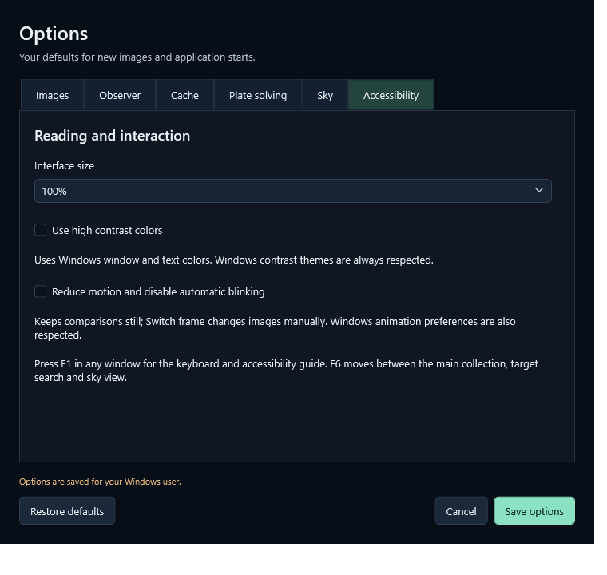

# Accessibility and assistive technology support

SkyBrowser provides keyboard workflows, Windows UI Automation information and
readability preferences. Press **F1** in any window for the in-app guide, or use
**Options > Accessibility**. This is implemented support with automated coverage;
it is not a claim of complete accessibility conformance.

## Reading and movement

- Interface size enlarges text and controls from 100% to 200%. Enlarged content
  remains scrollable and Tab brings focused controls into view. Lists keep finite
  viewports and virtualization.
- High contrast uses Windows window/text colors. Windows contrast themes are
  followed automatically, including changes while the app is open. The normal
  palette also uses brighter secondary text and stronger focus outlines.
- Reduce motion disables automatic comparison blinking. Windows' disabled client
  animations also stop blinking. Manual frame switching and swipe remain available.
- Common buttons, fields, checkboxes and dropdowns have a minimum 28-DIP height.
  Keyboard access avoids needing precise pointer movements.

## Keyboard and nonvisual workflows

Tab/Shift+Tab traverse controls, arrows select items/tabs, Space activates or
toggles, and Escape cancels dialogs. Dialog closure restores focus to the opener
when the dialog was active. F6/Shift+F6 cycle the collection, target search and sky.
Ctrl+F searches images, Ctrl+O adds images, Ctrl+L opens the library and Ctrl+comma
opens Options. F1 opens a selectable, readable keyboard guide.

Custom sky, world map, 3D map and visibility chart controls have automation peers
with read-only Value patterns. They expose real coordinates, current selection or
time samples rather than an unexplained graphic. Their HelpText describes the
keyboard interactions. Standard controls retain native automation patterns.

| Feature | Nonvisual / keyboard alternative |
| --- | --- |
| Sky navigation | Search named targets or enter RA/Dec; arrows pan, +/- zoom, Home resets |
| Image selection and inspection | Named image collection, visibility/actions, Space selects the sky-center image, Enter inspects |
| Location | Named numeric latitude/longitude inputs; map arrows and readable position |
| Visibility | Written event/imaging-window results; chart Left/Right/Home/End read time samples |
| Angular measurement | Four named coordinate inputs and Measure coordinates; catalogue pairs remain available |
| Full-resolution samples | Named X/Y inputs and Read pixel; image arrows/Shift+arrows/Home/End navigate stored samples |
| 3D distances | Named searchable list, Select second target and written distances/source details |
| Comparison | Keyboard swipe slider, linked views and manual Switch frame |

Validation, operation status and result messages raise polite LiveRegionChanged
events after a short debounce. Duplicate/empty text is suppressed; ordinary clock
ticks and mouse-hover readouts are not live announcements. Custom values raise
property-change events only when clients are listening. Automation connections
are disconnected when the application exits.

## Verification and limits

`SkyBrowser.UiTests` launches the actual executable with isolated profiles and
tests keyboard/mouse behavior through UIA3. It covers names/roles/patterns,
readable custom views, focus restoration, live validation announcements,
coordinate measurement, planning, preferences and 200% keyboard reachability.
The shared WPF scenario additionally checks actual contrast brushes, secondary
text contrast and bounded enlarged layout. The UI suite checks read-only view values. Settings tests
exercise persistence in a new process. Run desktop suites serially.

Release acceptance should additionally include real Narrator and NVDA sessions,
Windows contrast themes with custom colors, Magnifier, multiple monitor DPI
settings, touch/switch/voice input and users with disabilities. UI Automation
tests do not establish spoken phrasing, reading order in every screen reader,
or independent completion of every application task. The visual celestial scene
and scientific images retain their actual imagery; text alternatives describe
coordinates, selection, samples and results rather than interpreting a photograph.

Reference: Microsoft's [Windows accessibility guidance](https://learn.microsoft.com/windows/apps/develop/accessibility)
and [custom WPF automation peers](https://learn.microsoft.com/dotnet/desktop/wpf/controls/ui-automation-of-a-wpf-custom-control).
