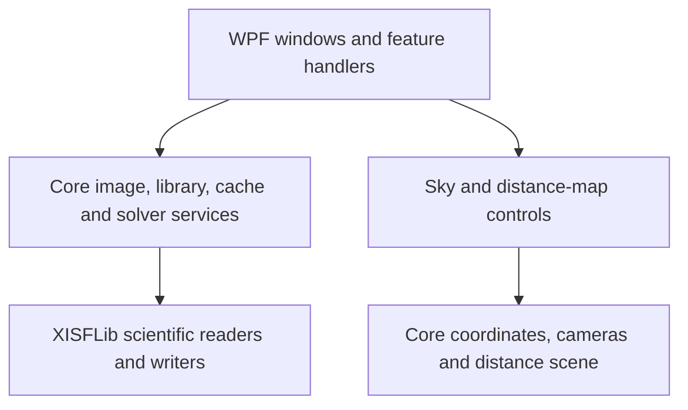

# Architecture and state ownership

SkyBrowser has two application projects. `SkyBrowser.Core` owns scientific models,
image processing, persistence and external data/solver services. It targets .NET
without WPF. `SkyBrowser.Desktop` composes these services and owns Windows controls,
rendering and user interaction. The pinned XISFLib project reads scientific files.

## Desktop composition

The main window owns its library, preview loader/cache, options, child windows and
shared operation/progress identity. Its partial files organize handlers by workflow
while preserving one window and one owner for cancellation and busy state.

| File | Responsibility |
| --- | --- |
| `MainWindow.xaml.cs` | Composition, window lifetime, shared busy/status state and options |
| `MainWindow.Loading.cs` | Startup, image/folder imports and guarded processing progress |
| `MainWindow.Inspector.cs` | Selected-image details, display changes and manual placement |
| `MainWindow.Navigation.cs` | Target search, camera commands, observer and timeline |
| `MainWindow.Export.cs` | Display export, ASTAP solving and saved scientific copies |
| `MainWindow.Collection.cs` | Collection filtering/sorting, organization, comparisons and batch actions |
| `MainWindow.SkyTools.cs` | Survey service/restore lifetime and Sky tools window ownership |

`SkyToolsWindow.xaml.cs` owns initialization and the window lifetime. Its Surveys,
Visibility, Measurements, Distances and Framing partial files own their respective handlers.
Survey and visibility operations have separate cancellation identities, both linked
to the window lifetime. Closing the window cancels them and detaches atlas events.

These files remain UI adapters. Source decoding, solver execution, persistence and
numerical calculations belong in Core services. WPF control access stays on the
dispatcher; expensive services run off it. Late callbacks must still check closing,
operation identity and the relevant item/revision before changing the scene.

## Rendering and distance-map state

`ImageComparisonGeometry` in Core owns comparison eligibility from spherical
footprint overlap and aspect-aware framing of both image meshes through shared sky.
The desktop command and comparison window enforce the same eligibility rule.

`SkyViewport` owns textured meshes, layer subscriptions, camera interaction and
transient atlas annotations. `SkyViewport.Drawing.cs` owns its nested background/
foreground drawing implementation and bounded text caches. Survey viewports retain
separate depth buffers and a shared camera. Scientific placement models remain in
Core and are independent of display-mesh approximation.

`DistanceSpaceScene` owns the independent 3D camera, primary target, comparison
target and immutable pair measurement. Primary selection frames the object and
clears any previous pair. Adding B retains navigation. Recentring preserves scale;
framing the pair and resetting to the Sun are explicit scene operations. The pair
result is calculated when selection changes and reused during drawing.

`DistanceSpaceView` adapts mouse/keyboard input and screen picking to those scene
operations, forwarding its established control events to the window. Its drawing
partial projects and sorts symbols, places labels and renders guides/pair overlays.
The window owns search controls, display choices and source/result presentation.
The scene has no dependency on WPF controls or the dispatcher and can be tested
without creating a window.

`DistanceSpaceCamera` retains its orientation basis between projections. Orbit and
Home invalidate that basis; framing, movement and zoom change position or scale
without changing the axes. This keeps catalogue and guide projection inexpensive.

`SkyImageLayer` owns the consistency of its image, bitmap and placement. Display
replacement prepares all three before raising notifications, and rebuilds manual
geometry if the source dimensions changed. Callers batch viewport updates while
publishing a replacement; they do not reapply manual placement themselves.
Astrometry-only replacements reuse the existing preview bitmap.

## Persistence and scientific boundaries

`AstapPlateSolver` creates one scientific temporary input and validates/commits the
result. Its Hints partial parses approximate source coordinates and instrument
scale without granting them placement status; its Search partial owns the bounded
nearby attempt, full-sky fallback, shared deadline and process cleanup. Failed hints
cannot contaminate the fallback's output or override an explicit user field height.

`MosaicPlan` in Core owns rectilinear fields, tangent-plane grid spacing, spherical
panel centers and parallel-transported orientations. `SmartTelescopeProfiles`
loads the embedded manufacturer-sourced native-field snapshot. `EquipmentProfileStore`
atomically saves custom configurations beside options, with bounded reads and backup
recovery. It is independent of the preview and survey caches. The atlas owns the
transient plan, so closing Sky tools retains its overlay; no workspace restoration
is implied. Input edits invalidate the overlay/export until explicitly applied.
CSV exports use invariant J2000 degrees/hours and actual per-panel CCW rotations.
Selecting a panel can populate the existing visibility planner. Planning input
changes cancel pending work and clear stale charts/reports.

The durable library, preview cache, survey cache and application options have
different lifetimes. Keep those stores separate. Cache loss must not remove library
organization or other durable library records, or hide an otherwise readable image. Source signatures bind
cached previews and saved astrometry to their original scientific files.
Individual damaged preference or survey records must not hide other valid records.
Validate survey metadata, SQLite storage types and request keys before exposing
saved regions; restoration still validates the scientific payload separately.

`LoadedSkyImage` retains file astrometry when applying a local ASTAP overlay and
exposes its provenance through `HasAstapSolution`. The preview cache stores the
file's placement and warning, independent of that overlay. `ImageLibrary.ForgetSolution`
deletes the selected path/image-index solution and updates its indexed placement
flag in one transaction, then returns the retained file placement without decoding.
The desktop publishes that replacement immediately while preserving manual placement
and display state. Other solutions and library organization remain intact. Solved
exports recheck the durable record, so stale scene snapshots cannot export a solve
that has been forgotten.

Numerical/format contracts and source attribution are detailed in the
[technical reference](technical-reference.md). Rendering and refactoring must
preserve exact coordinate readouts, source samples, row orientation and retained
metadata. Source photographs are never rewritten for display or caching.

## Extending and checking changes

Accessibility is shared through the Window style, `Services/Accessibility.cs`
(focus and debounced announcements) and `AccessibilityPreferences` (dynamic
palette, bounded scaling and motion settings). Custom view peers read existing
state rather than duplicate scientific models. Keep nonvisual coordinate/sample
workflows available alongside rendered views; see [accessibility](accessibility.md).

Add domain rules to Core when they can be expressed independently of controls.
Keep handler orchestration in the owning feature file and rendering in its drawing
implementation. Preserve a single owner for mutable state and cancellation rather
than copying it into each partial.

Test domain transitions directly. Use the shared WPF integration scenario for
window interactions, cancellation and rendering; WPF permits only one Application
per process. Compare deterministic scene captures when moving drawing/input code.
`tests/SkyBrowser.UiTests` adds a separate-process FlaUI/UIA3 layer: launch the real
executable, locate controls by accessible role/name, and exercise keyboard and
mouse workflows without constructing windows or calling handlers. These tests
use isolated settings/library/cache directories and share desktop focus, so run
them serially and separately from other desktop tests.
The established scientific, persistence and source-preservation tests remain the
regression contract. New files are included by the SDK project globs and ordinary
Debug/Release builds need no extra generation step.
