# SkyBrowser

## Beginner's user manual

Explore your astronomical photographs in their place on the sky. SkyBrowser combines your FITS and XISF images with a simple star map. You can look around, compare photographs and return to your saved image folders later.

<!-- figure height=220 crop=0,0,1424,881 markers=1:0.89:0.044;2:0.218:0.25;3:0.218:0.67;4:0.951:0.2 -->

- **1. Top bar:** see the app version, open Options and add images.
- **2. Image collection:** open the library, search loaded images and choose one.
- **3. Selected image:** change the chosen image's appearance, visibility and placement. Drag the divider above this panel to resize it.
- **4. Sky view:** drag to look around and scroll to zoom. The bottom status bar reports progress and problems.

| Start here | Page | Explore further | Page |
| --- | --- | --- | --- |
| Load your first images | 2 | Overlapping photographs | 6 |
| Navigate and find a target | 3 | Location and observing time | 7 |
| Collection and image details | 4 | Options and the cache | 8 |
| Choose an image display | 5 | Loading and cancellation | 9 |
| Return to saved folders | 10 | Place an unsolved image | 11 |
| Troubleshooting | 12 | Quick reference | 13 |
| Image library and ASTAP | 14 | Full-resolution inspection | 15 |

> **Your originals stay safe.** Display changes, blending and placement do not rewrite your scientific image files. Keep your originals available for future starts.

---

# 01 / Your first images

## Start with the defaults

1. Open **SkyBrowser.exe** from the published application folder.
2. On the welcome screen, keep **Automatic · dark sky (fast)**. It makes dark, unstretched data easier to see without the slower cleanup steps.
3. Your observing location is optional. Leave it empty to explore the sky as an atlas, or choose **Choose on map...** to set it now. You can change it later in Options.
4. Choose **Save & start**. **Use defaults** also saves the factory choices. **Not now** continues without saving setup; it can appear again next time.

<!-- figure height=250 crop=0,0,644,562 -->
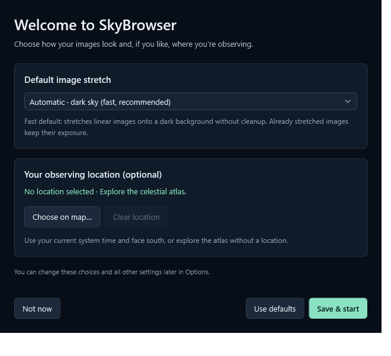

## Load and frame a photograph

1. Choose **Image library**, then **Add folder...** to build your list of image folders.
2. Choose **Load folders** to load their images, including subfolders. Then double-click a collection entry, or use **Go to image**, to frame it.
3. Drag the sky to move around and scroll to zoom in or out.

Use **+ Add images** or drop files onto the window for individual imports. Your saved folders reopen automatically on startup, using cached previews when valid and loading source files when needed. See page 14 for folder management.

> **Supported files:** .fits, .fit, .fts, .xisf and .xish. Keep distributed XISF headers with their data files. Images need a usable sky solution to appear automatically; see page 11 for **Needs placement** and ASTAP solving.

Recognized Bayer metadata automatically produces a color preview. Missing or unsupported masks stay grayscale; original files are unchanged.

---

# 02 / Explore the sky

## Move around

| Action | How to do it |
| --- | --- |
| Look in another direction | Drag an empty part of the sky with the left mouse button. |
| Zoom | Scroll the mouse wheel, or use the + and - buttons above the sky. |
| Frame the selected image | Choose Go to image, or press F while the sky has focus. |
| Return to a wide view | Choose Overview, or press Home while the sky has focus. |

The switches control the grid, constellation lines, labels and image outlines. Atlas mode uses **RA/Dec grid**; an observing location switches to **Alt/Az grid**, fixed to the local horizon.

## Find a named object

1. Expand **Find in the sky** in the upper left of the sky view.
2. Type a name or catalogue number, such as **M31**, **IC 434**, **NGC 253** or **Horsehead**.
3. Optionally choose Messier, Caldwell, NGC or IC to narrow the catalogue.
4. Open the results list and choose an object. The sky turns toward it, adds a marker and fills in its coordinates.

<!-- figure height=200 crop=350,140,678,359 -->
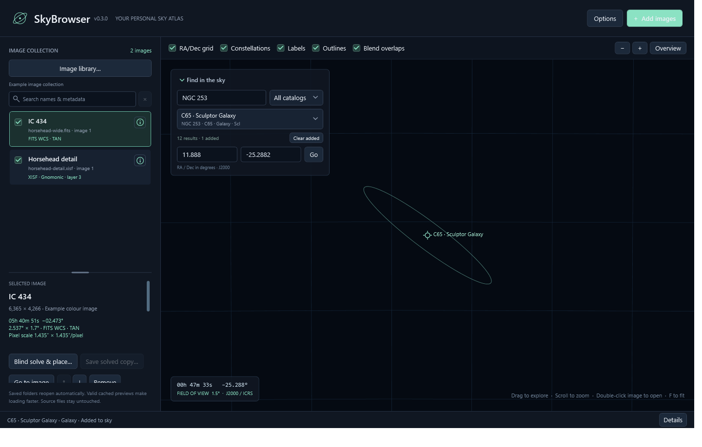

The finder includes Messier and Caldwell objects plus NGC and IC entries with known positions. Initially, only a small selection of prominent targets is labelled. **Clear added** removes the markers you have added; it keeps your photographs.

The shared **Go** button returns to the selected target. You can also enter a known **RA** and **Dec**, then choose Go. Both input boxes use decimal degrees. The sky's RA readout may use hours, so do not paste an hours/minutes/seconds value into the degree input. Collapse the finder again to recover space.

> **A catalogue marker is a signpost.** Finding an object does not download its photograph. Add your own image files to see photographs at that position.

---

# 03 / Your image collection

## Choose, hide and search

Click an image's entry to show its controls under **Selected image**. Its checkbox hides or shows it on the sky. **Remove** takes it out of this collection; it does not delete the source file. The arrow buttons reorder entries. Drag the horizontal divider to give the collection or the selected-image controls more room.

Use **Search names & metadata** to find an image by filename, target, telescope, filter or other retained metadata. **ic434**, **IC 434** and **IC-434** match the same target. Multiple words narrow the results: try **IC 434 H-alpha**. Press **Ctrl+F** to focus search; the x button or Escape in the search box clears it.

> **Search filters the list.** An image hidden from the search results can still be visible on the sky. Use its checkbox to hide it from the sky itself.

## Inspect the information behind a photograph

Choose the small circled **i** beside an entry to open **Image details**. The window shows its preview, source path, original and preview dimensions, file size, display mode and sky placement. Search the metadata table to find a keyword, value or comment. Select a row to read and copy its value in the box below.

<!-- figure height=230 crop=0,0,884,762 -->
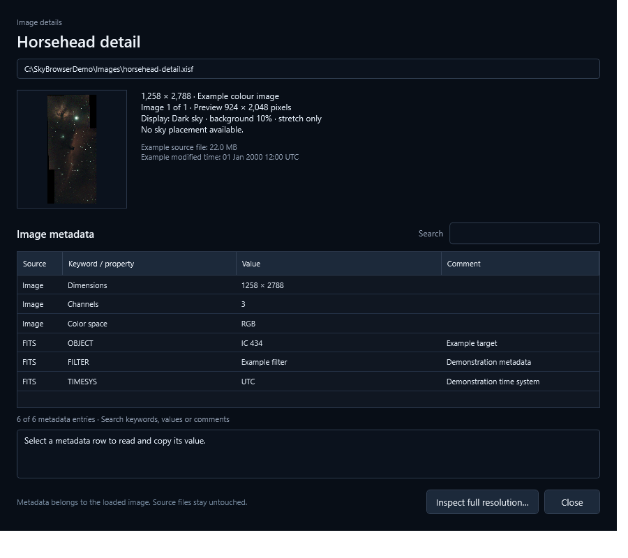

**Double-click a photograph in the sky** to inspect it internally, choosing the foremost overlapping image. **Inspect full resolution…** here or under Selected image also opens 100% zoom, source values, sky coordinates, histograms and statistics (page 15).

To open the original in the Windows default application, use the small arrow button in a corner of the hovered or selected sky image. Zoom in if the photograph is too small to show it. Large metadata values may be shortened.

<!-- figure height=75 crop=500,40,620,150 -->
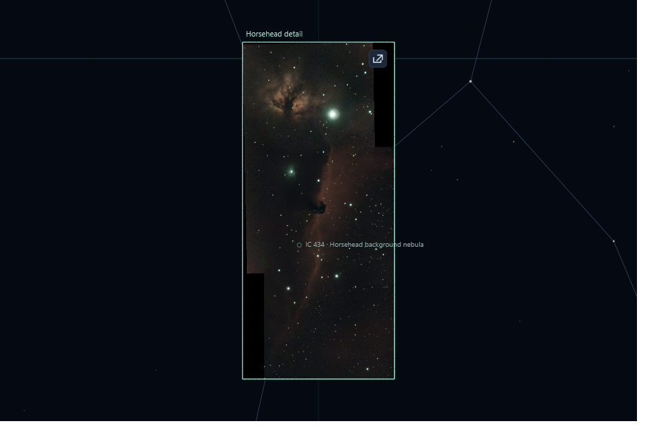

---

# 04 / Make images easy to see

Many astronomical files store **linear**, or unstretched, data. They can look almost black until a display stretch makes faint detail visible. SkyBrowser changes the preview, while keeping your source file intact.

Select an image and use its **Display** list. Changing a mode may take a moment to process.

| Display choice | When to use it |
| --- | --- |
| Automatic · dark sky (fast) | Start here. Uses a stored display function when present; otherwise detects dark linear data and stretches it. It skips cosmetic cleanup. |
| Linear / already stretched | Use when your image already looks right and should keep its existing exposure. |
| Library auto stretch (25%) | An alternative, usually brighter automatic display stretch. |
| Stored display function | Uses the display settings saved inside the image file. Without them, it uses a linear display. |
| Dark sky + cleanup | Adds the enabled background, noise and detail adjustments. The first processing pass takes longer. |

## Adjust one image

Expand **Sky background & cleanup** in Selected image. A lower sky-background target makes the background darker. Start near **10%**, then adjust gently. Choose the cleanup options you want and select **Apply finish**. This switches that image to **Dark sky + cleanup**. If a large nebula seems affected, try turning off **Reduce broad sky gradients**.

## Choose defaults for future loads

Open **Options > Images**, choose a default stretch and background target, then **Save options**. Automatic uses only the background target, even when the cleanup boxes are checked.

<!-- figure height=210 crop=24,138,720,508 -->
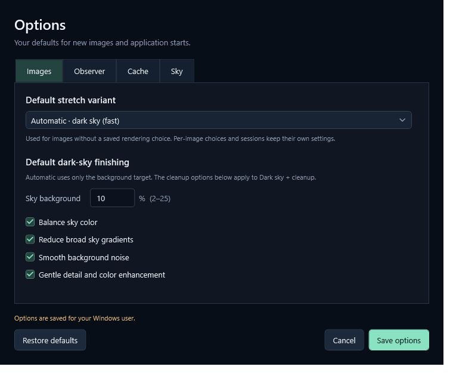

Saved per-image choices take precedence over global defaults. Saving Options does not reprocess the images already on screen. **Reset defaults** in Selected image applies your saved image defaults to that image.

---

# 05 / Compare overlapping images

SkyBrowser can show a wide photograph and a closer view of the same region together. Matching uses the images' positions and sky coverage, so their filenames do not need to match.

1. Add both photographs. For example, load the wider Horsehead FITS image and the narrower IC434 XISF image from the project's examples folder, if available.
2. Turn on **Blend overlaps** above the sky.
3. Frame either image with **Go to image**. The photograph covering more sky forms the background. A smaller overlapping image becomes a translucent inset.
4. Move the pointer over the inset to reveal it at full opacity. Move away to restore the blend.

<!-- pair -->
<!-- figure height=280 crop=680,193,1075,774 -->
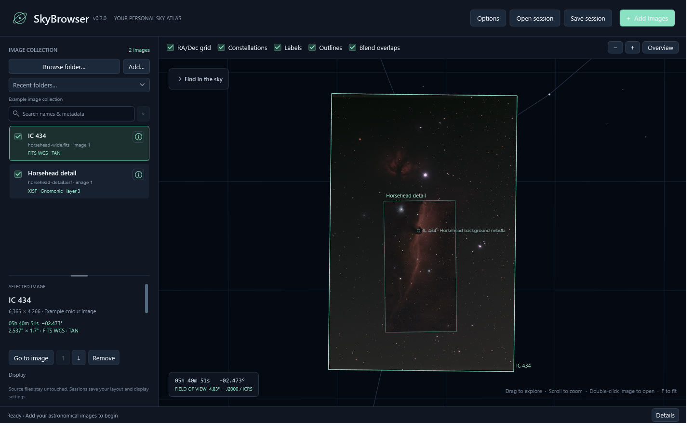
<!-- figure height=280 crop=680,193,1075,774 -->
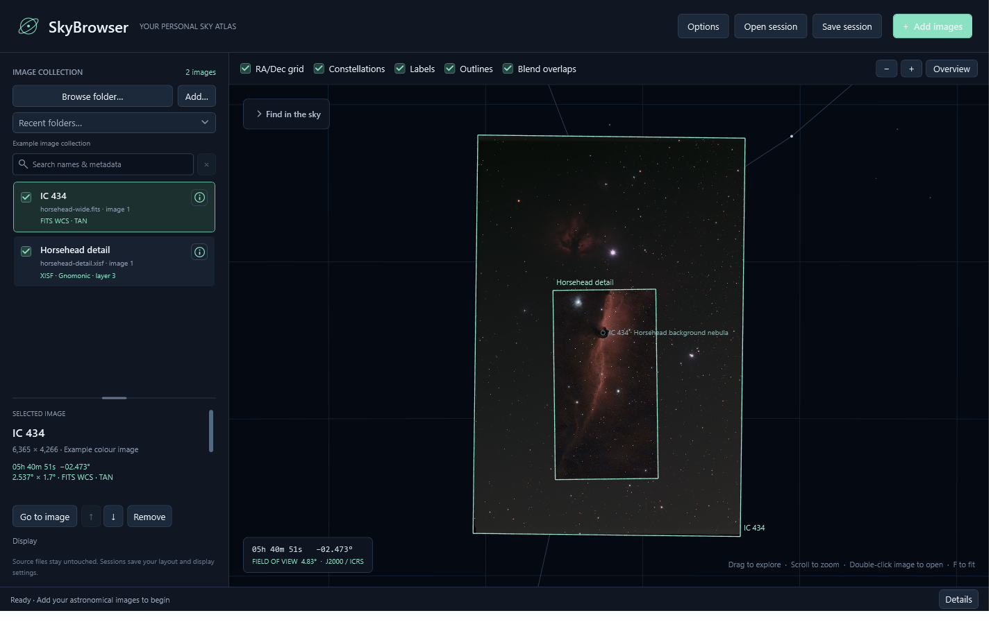

## Opacity and ordering

The selected image's **Opacity** slider controls how strongly it appears. With blending enabled, an inset normally uses 60% of that chosen opacity. Hovering temporarily makes it fully opaque; it does not change the saved slider value.

Turn **Blend overlaps** off to use collection order instead. Later entries are drawn above earlier ones; use the arrow buttons to change that order. Hiding a larger background can make its remaining inset opaque when no larger overlapping background remains.

> **Larger means more sky, not more pixels.** A high-resolution close-up can still be the smaller inset. Blending and hovering change transparency only; they do not stretch the image again.

---

# 06 / Set your location and time

This is optional. Without a location, SkyBrowser works as a celestial atlas. With a location, it rotates the view to your local horizon and starts facing south.

1. Open **Options > Observer** and choose **Choose on map...**.
2. Click your location on the map. Drag to pan and scroll to zoom. For precision, enter latitude and longitude; negative numbers mean south or west.
3. Leave **Use current system time** checked for a live sky, or uncheck it to choose a fixed date and time.
4. Choose **Apply & face south** to return to Options, then **Save options** to apply and remember the choice.

<!-- figure height=225 crop=0,0,984,672 -->
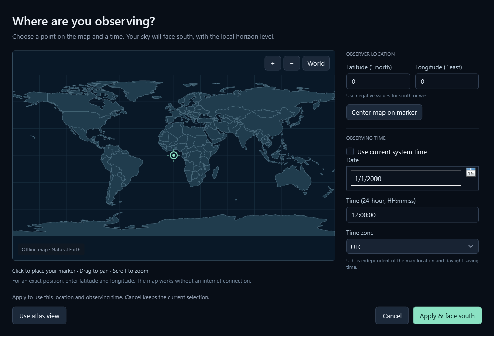

## Move through time

With a location selected, **Scene time** appears below the sky. Drag its slider backward or forward up to 12 hours. This pauses the live clock; **Live now** returns to the current system time. **-1 day** / **+1 day** move 24 hours and recenter the slider. With the slider focused, arrow keys move one minute; Page Up/Down move one hour.

<!-- figure height=63 crop=330,766,1034,846 -->
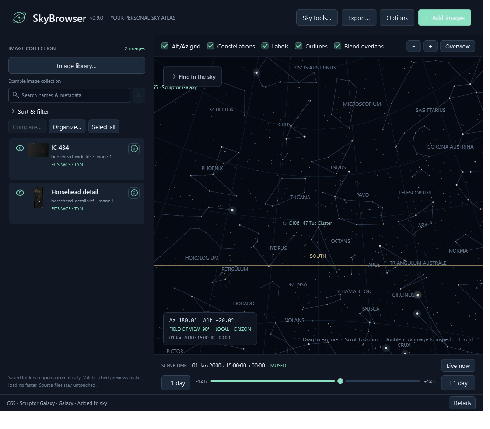

The readout uses your computer's time zone and UTC offset, not a zone inferred from the map. Options also accepts fixed UTC times. Moving time keeps your direction and zoom and does not reprocess images. The current scene time does not change your saved startup options.

The view starts south, 20 degrees up; **Overview** returns there. **ZENITH** marks straight up (90 degrees). **Polaris** is roughly your latitude above north, reaching overhead only near the North Pole. Use **Clear location > Save options** to return to the atlas and hide the timeline.

> **A simple sky guide:** the map works offline. The horizon does not include mountains, atmospheric effects, daylight or weather. Supported observing dates run from 1900 to 2100.

---

# 07 / Options and a faster library

Choose **Options** in the top bar. Use **Save options** to apply changes; **Cancel** discards staged changes. The tabs cover:

| Tab | What it controls |
| --- | --- |
| Images | Default display stretch, sky background and cleanup choices. |
| Observer | Your optional startup location and live or fixed observing time. |
| Cache | Where processed previews are stored and how much space they can use. |
| Plate solving | ASTAP executable/database, time limit and image-height hint. |
| Sky | Startup grid, constellations, labels, outlines and overlap blending. |

## Let the cache do the repeated work

The first load may be slow, especially for large images or cleanup. SkyBrowser saves processed previews locally and reuses them on later visits, including after closing and restarting the program. New or changed source files and new display settings can require processing again.

<!-- figure height=205 crop=24,99,720,508 -->
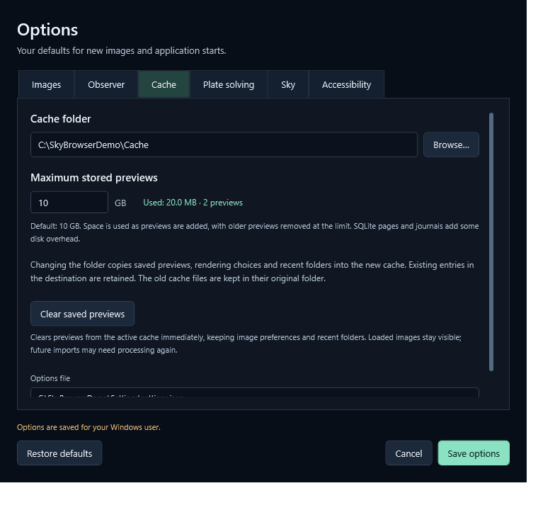

The default limit is **10 GB**. This is a maximum for stored preview data, not space reserved immediately. Older previews are removed as the limit is reached; database overhead can use some extra disk space. Choose a fast local drive with enough free space for a responsive experience.

Changing the cache folder copies cached content when you save. Old cache files remain. **Clear saved previews** clears previews immediately, even if Options is cancelled. It keeps loaded images, image choices, archive metadata and ASTAP solutions; later loads may need processing again.

> **Where settings live:** Options are saved for your Windows user in **%LOCALAPPDATA%\SkyBrowser\settings.json**, separately from the preview database. The Cache tab also shows the options-file path. A cache is disposable; it is not a backup of your images.

---

# 08 / Loading and cancellation

Longer loads open a progress window after a short delay. Fast cached visits may finish before it appears.

<!-- figure height=250 crop=0,0,524,366 -->
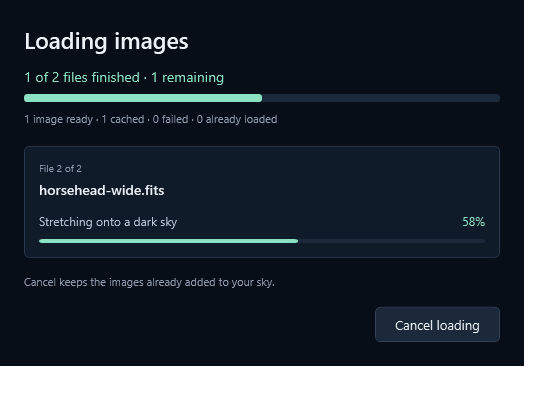

The window shows the current filename, completed and remaining entries, the processing step and counts of ready, cached, failed or already-loaded images. Folder imports count files; one file can contain multiple images. A pulsing bar means the current step has no percentage to report.

Choose **Cancel loading**, press Escape in that window, or close it to stop. Some decoding and cleanup steps must finish before cancellation completes. The display shows **Stopping...** while it waits.

- During an import, images already added stay available; remaining files are not started.
- During a display change, cancellation keeps the previous preview.

If a file fails, other files can still load. Read the message in the bottom status bar and choose **Details** there for more information. The status-bar Details button is an operation log; the small circled i in an image entry opens that image's metadata.

> **If loading seems slow:** let the first visit finish so its previews can be saved. Keep Automatic as your default for quicker processing, and choose cleanup only for images that benefit from it.

---

# 09 / Return to your saved folders

SkyBrowser opens the images in your saved library folders automatically when the application starts. You do not need to open a separate file to restore the collection.

<!-- workflow -->

## Set up your folders once

1. Open **Image library**, add your image folders and choose **Load folders**.
2. Let their images finish loading. Previews and per-image display choices are kept locally.
3. Close the application when finished. Next time, your saved folders load automatically, including subfolders.

## What happens on startup

Valid cached previews load first, with their metadata and sky placement, without decoding or stretching the scientific pixels again. A new image, missing preview, changed source or changed XISF sidecar is loaded from its source file and cached for later starts. Newly added files in saved folders are discovered too.

> **Keep your originals available.** Cached previews are validated against the original files and their sidecars. The cache speeds up loading; it is not an image backup. Unavailable folders stay saved and are reported in **Details**.

| Stored here | What returns later |
| --- | --- |
| Image library | Your folder list and source-bound ASTAP solutions. |
| Preview cache | Processed previews and per-image display/cleanup choices. |
| Options | Startup display defaults, sky toggles and observer settings. |

Visibility, opacity, hand-entered placement, added target markers and camera adjustments apply to the current sky. Set startup defaults in **Options**. For a portable plate solution, use **Save solved copy...** after blind solving.

## Change what opens next time

Use **Image library → Remove selected** or **Remove all**, then **Load folders** to confirm. **Cancel** keeps the previous folder list. Individual files opened with **+ Add images** do not add their parent folders to the saved list.

---

# 10 / When an image needs placement

Automatic placement requires a stored **astrometric solution**, often called a **plate solve**. It tells the program which sky direction belongs to each part of an image. A target name or acquisition coordinates alone are not enough to determine its width, rotation and possible reflection.

An image marked **Needs placement** has no usable position on the sky. Install ASTAP and a star database, configure **Options → Plate solving**, then select the image and choose **Blind solve & place...**. No approximate coordinates are required. The solution is saved locally without rewriting the original. See page 14 for setup and cancellation.

## Optional: place it by hand

If you already know the necessary values, select the image and expand **Manual sky placement**. Enter:

| Input | Meaning |
| --- | --- |
| Center RA | Right ascension of the image center, in decimal degrees from 0 to 360. |
| Center declination | Degrees north or south of the celestial equator, from -90 to +90. |
| Width | The full angular width of the image in degrees, not its pixel count. |
| Rotation | Zero means north up and east left. Positive values turn the image counterclockwise on the sky. |
| Mirror horizontally | Reverses the image horizontally when needed to match its orientation. |

Choose **Apply placement**, then **Go to image**. Inspect alignment against known objects and nearby images. **Use file solution** removes the manual override and returns to the loaded solution, including a retained ASTAP result. Hand-entered placement applies to the current sky.

> **Manual placement is approximate.** A plausible position is not proof of an accurate alignment. Wide or distorted fields especially benefit from a proper plate solve. Moving or stretching a preview does not repair the original file's astrometric metadata.

## If a solved image still cannot be placed

Read its warning in Selected image or the status-bar **Details** log. Some stored projections, distortion models and coordinate reference systems are not supported. A compatible J2000/ICRS solution or a manual placement may be needed. Use the image's circled i button to inspect its retained metadata.

---

# 11 / Common questions

| What you notice | What to try |
| --- | --- |
| An image is listed but not visible | Check its visibility checkbox and opacity. Clear the collection search, select it and choose Go to image. If it says Needs placement, follow page 11. |
| A photograph is too bright | Try Automatic or Linear / already stretched if it was previously processed. For cleanup, lower the sky-background target and select Apply finish. |
| A photograph is almost black | It may be linear data. Try Automatic or Dark sky + cleanup, and allow processing to finish. |
| A nebula changes too much with cleanup | Try disabling Reduce broad sky gradients or other cleanup options. Automatic provides a stretch without those cosmetic steps. |
| Fewer entries appear in the collection | Look for an active search. Clear it with the x button. Filtering the list does not hide photographs from the sky. |
| A new default does not change a loaded image | Options do not reprocess the current collection. Use Reset defaults in Selected image. Remembered per-image choices can override global defaults. |
| A file fails to open | Read status-bar Details. Check that it still exists, its format is supported, and any distributed XISF data files are present. |
| The corner arrow cannot open a source | Check that the original file exists and Windows has a default application for FITS/XISF. Double-click the photograph for internal inspection. |
| The local sky time seems wrong | Check your computer clock and time zone. For a fixed time, confirm Computer local time versus UTC. The map marker does not choose a time zone. |
| Loading is slow again after an update | Updated processing, changed sources, a new stretch variant or an evicted preview may need another processing pass. Later cached visits should be quicker. |

## Know which Details to open

The **circled i beside an image** shows that image's dimensions, source-file facts and metadata. The **Details button in the bottom status bar** shows loading messages and errors. Start with the status-bar log when something fails.

> **Settings will not save?** Check that your Windows user can write to the location shown in Options. For a cache-folder error, choose an accessible local folder. A failed save keeps the options or setup window open with an explanation.

---

# 12 / Keep this page handy

## Everyday controls

| Control | Result |
| --- | --- |
| Left-drag / mouse wheel over sky | Look around / zoom. |
| Arrow keys / + / - | Navigate / zoom while the sky has focus. |
| F / Home | Frame the selection / return to the overview while the sky has focus. |
| Ctrl+F | Focus collection search. |
| Escape in collection search | Clear the search. |
| Escape in the loading window | Request cancellation. |
| Double-click a collection entry | Frame that image. |
| Double-click a photograph in the sky | Inspect full resolution internally. |
| Corner arrow on a hovered or selected sky image | Open its original in the Windows default application. |
| Drag the collection divider | Resize the collection and Selected image panels. |

## A few useful words

- **FITS / XISF:** scientific image-file formats that can store pixels and information about the observation.
- **Metadata:** information saved with an image, such as target, filter, telescope, exposure and coordinates.
- **Stretch:** a display adjustment that makes faint detail visible. It does not change your source image here.
- **RA / Dec:** right ascension and declination, the sky's position coordinates. SkyBrowser's input boxes use decimal degrees.
- **Field of view:** how much sky you can see. A smaller angle gives a closer view.
- **Plate solve / astrometric solution:** information connecting image positions to sky coordinates.
- **Cache:** saved processed previews used to speed up future visits, including after restarting.

## A simple routine

Keep **Automatic** as your default. Browse one folder, select an image and choose **Go to image**. Look around and try the finder; your saved image folders reopen next time. Add a location or cleanup only when you need it.

This guide describes the current Windows desktop application. Screenshots use anonymous demonstration paths, metadata and observing settings. Filenames, values and layout can differ on your computer. Sky-catalogue and map attributions are supplied with the application in **THIRD-PARTY-NOTICES.md**.

---

# 13 / Image library and ASTAP

## Keep an archive, choose a scene

Add folders in **Image library**, then confirm with **Load folders**. Their images, including subfolders, reopen automatically on the next application start.

<!-- figure height=175 -->
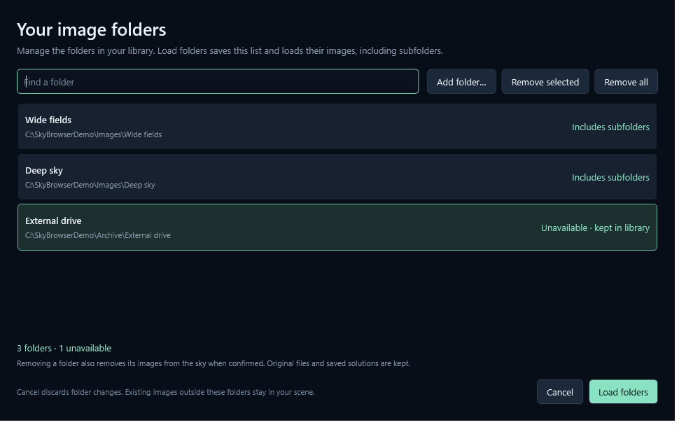

Use **Remove selected** (Ctrl/Shift for several) or **Remove all** to edit the list. **Cancel** discards edits. **Load folders** saves all listed folders, even those hidden by the folder filter. Confirmed removals take their images out of the sky; files and saved solutions stay safe. Unavailable folders remain listed for later use.

## Solve an image without knowing its coordinates

<!-- figure height=140 crop=20,90,700,415 -->
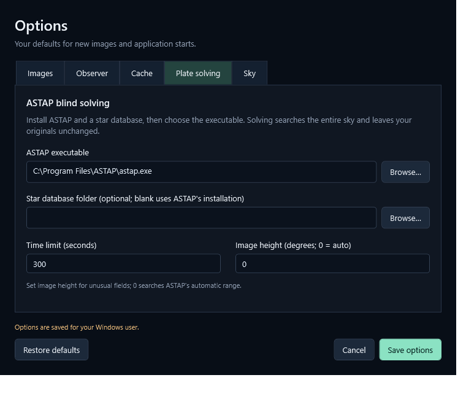

1. Install ASTAP and a star database. In **Options → Plate solving**, browse to **astap.exe** or **astap_cli.exe**. The optional database folder is useful for databases installed elsewhere.
2. Keep image height at **0** for automatic scale search, or enter its height in degrees for an unusually wide/narrow field. Save options.
3. Select an image and choose **Blind solve & place...**. ASTAP searches the whole sky. **Cancel loading** or the time limit stops it. The inspector shows fitted field size and pixel scale.
4. Choose **Save solved copy...** and select FITS or XISF to embed the solution in a new file with the original scientific pixels. The source stays unchanged. FITS may omit XISF-only metadata.

Local solutions survive clearing previews; changed source files invalidate them. Saved solved copies carry their astrometry between computers without requiring the local library.

---

# 14 / Inspect source pixels

Double-click a photograph in the sky, or choose **Inspect full resolution…** under Selected image or in Image details. This opens the scientific image in its own window with your selected display stretch. The sky keeps its smaller preview.

<!-- figure height=270 -->
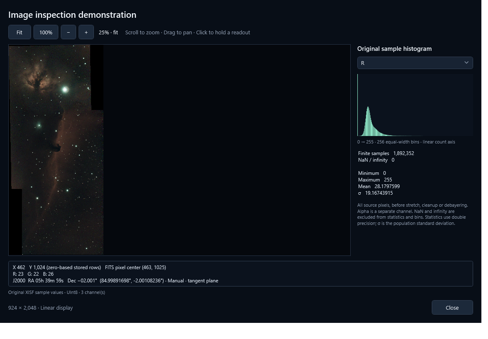

## Zoom, pan and read a pixel

- **100%** maps one source pixel to one screen pixel, including Windows display scaling. **Fit** shows the frame at up to 100%.
- Scroll or use **+ / -** to zoom; drag the image to pan. The sky camera stays where it was.
- Move over the image for zero-based X/Y, one-based FITS pixel centers and original sample values. Click to hold or release the readout for copying.
- J2000 sky coordinates appear when the file, saved ASTAP result or manual placement provides a supported solution. Manual coordinates remain approximate.

## Understand the measurements

Select a channel for its histogram, minimum, maximum, mean and population standard deviation. All source pixels contribute before stretch, cleanup or debayering. FITS values include BSCALE/BZERO scaling; undefined BLANK samples become NaN. Bayer readouts retain the original mosaic and alpha has its own channel.

The 256 histogram bins span the finite minimum/maximum with a linear count axis. NaN and infinity are counted separately and excluded from the measurements. Aggregate statistics use double precision, so very large integers can round; individual UInt64 sample readouts retain every bit.

> **Keep the original available.** Full-resolution loading needs memory and can take time. Close the window to cancel; a native decoder or filter may finish first. Missing or changing source files produce an explanation without changing your atlas or originals.
